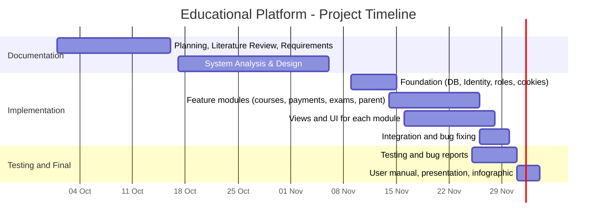

# 1.2 Project Plan

## Timeline (Gantt Chart)

## Milestones and Deliverables
| # | Milestone | Deliverables | Due date |
|---|-----------|--------------|----------|
| M1 | Planning, Literature Review, Requirements | Proposal, plan, roles, risks, KPIs, related systems, requirements | 16 Oct 2026 |
| M2 | System Analysis & Design | Use cases, architecture, ERD, DFD, sequence/activity/state/class diagrams, wireframes, deployment | 6 Nov 2026 |
| M3 | Implementation | Working MVC website, README with run instructions | 30 Nov 2026 |
| M4 | Testing and Final | Test plan and results, bug reports, user manual, technical documentation, presentation, infographic | 4 Dec 2026 |

> Milestone due dates follow the DEPI Project Documentation Guidelines.

## Resource Allocation
| Resource | Details |
|----------|---------|
| Team | 4 members (see [Task Assignment & Roles](03-task-assignment-roles.md)) |
| Tools | Visual Studio / VS Code, SQL Server, Git and GitHub |
| Workflow | `main` (submission), `develop` (integration), `feature/*` (one branch per task) with Pull Request and one review |
| Communication | Team chat group and GitHub Pull Requests |
