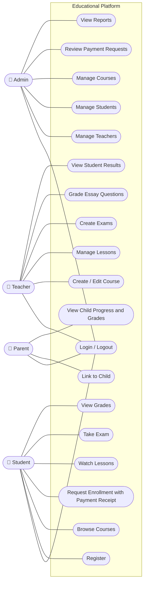

# 2. Use Case Diagram & Descriptions

## 2.1 Actors
| Actor | Description |
|-------|-------------|
| Admin | Manages teachers, students, courses, payment requests and reports |
| Teacher | Creates courses, lessons, exams and grades essay questions |
| Student | Enrolls in courses, watches lessons, takes exams, views grades |
| Parent | Follows linked children's progress and grades |

## 2.2 Use Case Diagram

> Relationships: *Watch Lessons* and *Take Exam* **require** an approved enrollment (precondition from *Review Payment Requests*). *Take Exam* is followed by *Grade Essay Questions* when the exam has essay questions.

## 2.3 Use Case Descriptions

### UC-01 Login / Logout
| Field | Description |
|-------|-------------|
| Actors | All |
| Precondition | Account exists and is active |
| Main flow | 1. User enters email and password. 2. System validates credentials. 3. System issues a JWT token. 4. User is redirected to the dashboard of their role. |
| Alternative | Invalid credentials → error message; account disabled → access denied |
| Postcondition | User is authenticated |

### UC-05 Review Payment Requests
| Field | Description |
|-------|-------------|
| Actor | Admin |
| Precondition | At least one payment request is Pending |
| Main flow | 1. Admin opens the Pending requests list. 2. Sees student, course, price, payment method and receipt image. 3. Approves the request. 4. System creates an Enrollment and notifies the student. |
| Alternative | Admin rejects with a reason → request becomes Rejected, student can resubmit |
| Postcondition | Request status updated; Enrollment created if approved |

### UC-06 View Reports
| Field | Description |
|-------|-------------|
| Actor | Admin |
| Main flow | Admin opens reports: number of students/teachers, enrollments per course, payment requests by status, revenue from approved requests. |

### UC-07 Create / Edit Course
| Field | Description |
|-------|-------------|
| Actor | Teacher |
| Main flow | 1. Teacher enters title, description, price, thumbnail. 2. System saves the course as Draft. 3. Teacher publishes when ready. |
| Postcondition | Course exists (Draft or Published) |

### UC-08 Manage Lessons
| Field | Description |
|-------|-------------|
| Actor | Teacher |
| Precondition | Teacher owns the course |
| Main flow | Add / edit / delete / reorder lessons (title, description, video link, order). |

### UC-09 Create Exams
| Field | Description |
|-------|-------------|
| Actor | Teacher |
| Main flow | 1. Teacher creates exam for a course (title, duration). 2. Adds MCQ questions (options + correct answer) and essay questions (marks). 3. Publishes exam. |

### UC-10 Grade Essay Questions
| Field | Description |
|-------|-------------|
| Actor | Teacher |
| Precondition | A student submitted an exam that contains essay questions |
| Main flow | 1. Teacher opens ungraded submissions. 2. Reads each essay answer. 3. Enters score and optional feedback. 4. System recalculates total score and marks attempt as Graded. |

### UC-14 Request Enrollment with Payment Receipt
| Field | Description |
|-------|-------------|
| Actor | Student |
| Precondition | Student logged in, not already enrolled in the course |
| Main flow | 1. Student opens course page and sees price. 2. Pays outside the system via InstaPay or Vodafone Cash. 3. Chooses payment method and uploads receipt image. 4. System creates a Pending payment request and shows it to the Admin. |
| Alternative | Rejected request → student can submit a new one |
| Postcondition | PaymentRequest = Pending |

### UC-15 Watch Lessons
| Field | Description |
|-------|-------------|
| Actor | Student |
| Precondition | Approved enrollment |
| Main flow | Student opens a course, selects a lesson, watches the video; system records lesson completion. |

### UC-16 Take Exam
| Field | Description |
|-------|-------------|
| Actor | Student |
| Precondition | Approved enrollment, exam is published, no previous attempt (or retake allowed) |
| Main flow | 1. Student starts exam (timer begins). 2. Answers questions. 3. Submits (or time ends). 4. System auto-grades MCQ. 5. If essays exist → status Submitted (waiting for teacher); else → Graded. |

### UC-17 View Grades
| Field | Description |
|-------|-------------|
| Actor | Student |
| Main flow | Student sees the list of exams with score, total and teacher feedback. |

### UC-18 Link to Child
| Field | Description |
|-------|-------------|
| Actor | Parent |
| Main flow | Parent registers and links to a student account using the student's email/code; the link is stored in ParentStudent. |

### UC-19 View Child Progress and Grades
| Field | Description |
|-------|-------------|
| Actor | Parent |
| Precondition | Parent is linked to the child |
| Main flow | Parent selects a child and sees enrolled courses, lesson completion percentage and exam grades. |
