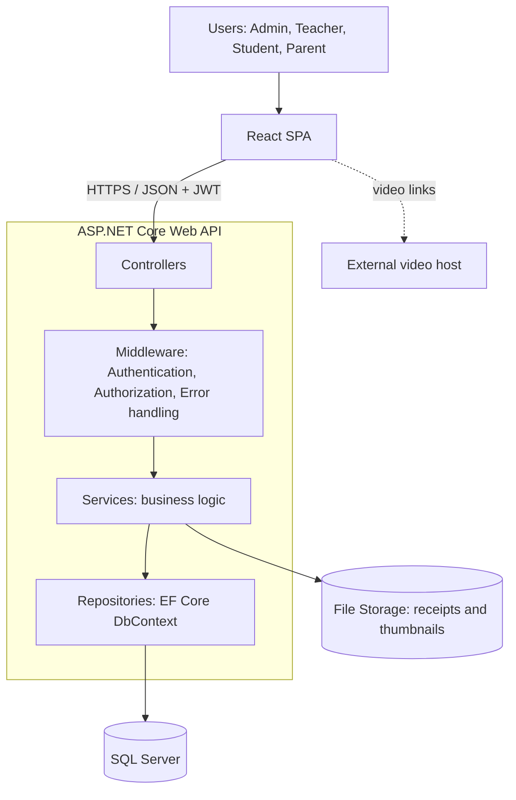

# 4. Software Architecture

## 4.1 Architecture Style
**Client–Server, layered (N-tier) architecture** with a **RESTful Web API**.

- **Presentation:** React single-page application (SPA).
- **Application:** ASP.NET Core Web API (Controllers → Services → Repositories).
- **Data:** SQL Server accessed through Entity Framework Core (Code-First).
- **File storage:** server file system for receipt images and thumbnails.

## 4.2 High-Level Architecture

## 4.3 Layer Responsibilities

| Layer | Responsibility | Examples |
|-------|----------------|----------|
| React SPA | UI, routing per role, calls the API, keeps JWT | Login page, Course page, Admin requests table |
| Controllers | Receive HTTP requests, validate DTOs, return responses | `AuthController`, `CoursesController`, `PaymentRequestsController`, `ExamsController` |
| Services | Business rules | Approve payment → create enrollment; auto-grade MCQ; calculate total score |
| Repositories / DbContext | Data access | `ApplicationDbContext`, EF Core entities |
| Database | Persistent storage | See [Database Design](05-database-design.md) |

## 4.4 Main Modules

| Module | Responsibility |
|--------|----------------|
| Auth | Register, login, JWT, roles |
| Users | Admin management of teachers/students, parent–student link |
| Courses | Courses and lessons |
| Payments & Enrollment | Payment requests, review, enrollments |
| Exams | Exams, questions, attempts, grading |
| Progress & Reports | Lesson progress, grades, admin reports |

## 4.5 Key Design Decisions
1. **JWT + role claims** keep the API stateless and easy to secure per endpoint.
2. **DTOs** separate API contracts from database entities.
3. **Service layer** holds all business rules so controllers stay thin.
4. **Manual payment review** is a workflow in the database (PaymentRequest status) instead of a gateway integration.
5. **Videos as links** avoid storage and streaming cost.
