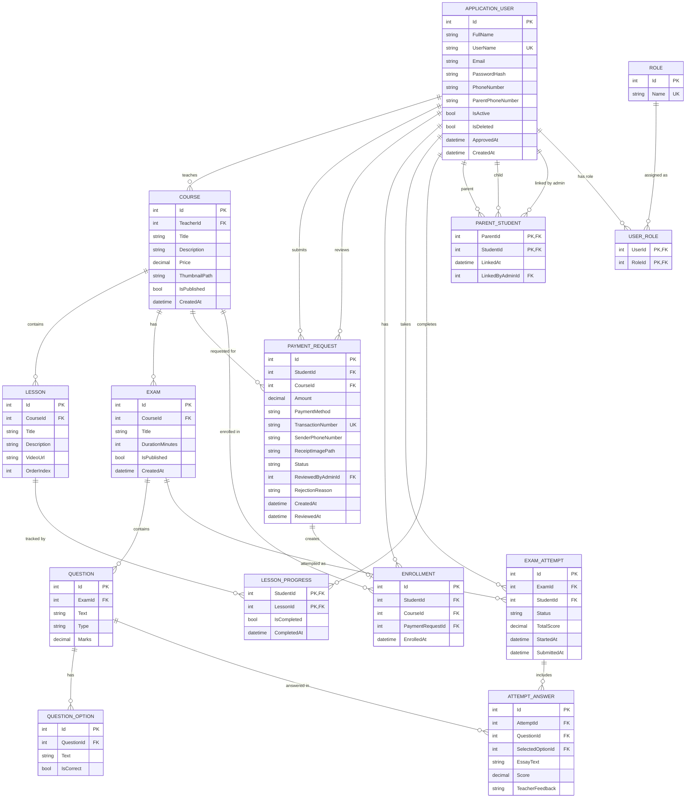

# 5. Database Design & Data Modeling

## 5.1 ER Diagram

> Users, roles and passwords are managed by **ASP.NET Core Identity**. In SQL Server the tables are `AspNetUsers` (our `ApplicationUser` class), `AspNetRoles` and `AspNetUserRoles`. Identity also creates a few extra tables (claims, logins, tokens) that the project does not use directly.

## 5.2 Logical & Physical Schema

**Conventions:** SQL Server, `int IDENTITY` primary keys, `nvarchar` for text (Arabic support), `decimal(10,2)` for money and marks.

### AspNetUsers (class `ApplicationUser`)
| Column | Type | Constraints |
|--------|------|-------------|
| Id | int | PK, identity |
| FullName | nvarchar(100) | NOT NULL |
| UserName | nvarchar(256) | UNIQUE (same value as the email) |
| Email | nvarchar(256) | NULL, indexed |
| PasswordHash | nvarchar(max) | Hashed by Identity, never the plain password |
| PhoneNumber | nvarchar(max) | Required for students and parents (format 01xxxxxxxxx). The application keeps it unique |
| ParentPhoneNumber | nvarchar(15) | NULL. Students only: the parent's phone entered at registration, used by the admin to create and link the parent account |
| IsActive | bit | NOT NULL. `false` means waiting for approval, suspended or deleted |
| IsDeleted | bit | NOT NULL, default 0. Soft delete: the account is hidden and cannot log in, but its history is kept |
| ApprovedAt | datetime2 | NULL. Time of admin approval. Empty means the account was never approved (pending) |
| CreatedAt | datetime2 | NOT NULL |

Identity adds more columns (security stamp, lockout, email confirmation, and others) that are managed by the framework.

### AspNetRoles
| Column | Type | Constraints |
|--------|------|-------------|
| Id | int | PK, identity |
| Name | nvarchar(256) | UNIQUE (via the normalized name). Seeded at startup: Admin, Teacher, Student, Parent |

### AspNetUserRoles
| Column | Type | Constraints |
|--------|------|-------------|
| UserId | int | PK, FK → AspNetUsers.Id |
| RoleId | int | PK, FK → AspNetRoles.Id |

### ParentStudents
| Column | Type | Constraints |
|--------|------|-------------|
| ParentId | int | PK, FK → AspNetUsers.Id |
| StudentId | int | PK, FK → AspNetUsers.Id |
| LinkedAt | datetime2 | NOT NULL |
| LinkedByAdminId | int | FK → AspNetUsers.Id, NULL (the admin who linked them) |

### Courses
| Column | Type | Constraints |
|--------|------|-------------|
| Id | int | PK |
| TeacherId | int | FK → AspNetUsers.Id, NOT NULL |
| Title | nvarchar(150) | NOT NULL |
| Description | nvarchar(max) | NULL |
| Price | decimal(10,2) | NOT NULL, ≥ 0 |
| ThumbnailPath | nvarchar(300) | NULL |
| IsPublished | bit | NOT NULL, default 0 |
| CreatedAt | datetime2 | NOT NULL |

### Lessons
| Column | Type | Constraints |
|--------|------|-------------|
| Id | int | PK |
| CourseId | int | FK → Courses.Id, ON DELETE CASCADE |
| Title | nvarchar(150) | NOT NULL |
| Description | nvarchar(max) | NULL |
| VideoUrl | nvarchar(400) | NOT NULL |
| OrderIndex | int | NOT NULL |

### PaymentRequests
| Column | Type | Constraints |
|--------|------|-------------|
| Id | int | PK |
| StudentId | int | FK → AspNetUsers.Id |
| CourseId | int | FK → Courses.Id |
| Amount | decimal(10,2) | NOT NULL (price at request time) |
| PaymentMethod | nvarchar(20) | NOT NULL, CHECK in (InstaPay, VodafoneCash) |
| TransactionNumber | nvarchar(50) | NOT NULL. UNIQUE together with PaymentMethod |
| SenderPhoneNumber | nvarchar(15) | NULL (wallet or account the student paid from) |
| ReceiptImagePath | nvarchar(300) | NOT NULL |
| Status | nvarchar(20) | NOT NULL, CHECK in (Pending, Approved, Rejected) |
| ReviewedByAdminId | int | FK → AspNetUsers.Id, NULL |
| RejectionReason | nvarchar(300) | NULL |
| CreatedAt | datetime2 | NOT NULL |
| ReviewedAt | datetime2 | NULL |

### Enrollments
| Column | Type | Constraints |
|--------|------|-------------|
| Id | int | PK |
| StudentId | int | FK → AspNetUsers.Id |
| CourseId | int | FK → Courses.Id |
| PaymentRequestId | int | FK → PaymentRequests.Id, UNIQUE |
| EnrolledAt | datetime2 | NOT NULL |
| | | UNIQUE (StudentId, CourseId) |

### LessonProgress
| Column | Type | Constraints |
|--------|------|-------------|
| StudentId | int | PK, FK → AspNetUsers.Id |
| LessonId | int | PK, FK → Lessons.Id |
| IsCompleted | bit | NOT NULL |
| CompletedAt | datetime2 | NULL |

### Exams
| Column | Type | Constraints |
|--------|------|-------------|
| Id | int | PK |
| CourseId | int | FK → Courses.Id |
| Title | nvarchar(150) | NOT NULL |
| DurationMinutes | int | NOT NULL |
| IsPublished | bit | NOT NULL, default 0 |
| CreatedAt | datetime2 | NOT NULL |

### Questions
| Column | Type | Constraints |
|--------|------|-------------|
| Id | int | PK |
| ExamId | int | FK → Exams.Id, ON DELETE CASCADE |
| Text | nvarchar(max) | NOT NULL |
| Type | nvarchar(10) | NOT NULL, CHECK in (MCQ, Essay) |
| Marks | decimal(5,2) | NOT NULL |

### QuestionOptions
| Column | Type | Constraints |
|--------|------|-------------|
| Id | int | PK |
| QuestionId | int | FK → Questions.Id, ON DELETE CASCADE |
| Text | nvarchar(300) | NOT NULL |
| IsCorrect | bit | NOT NULL |

### ExamAttempts
| Column | Type | Constraints |
|--------|------|-------------|
| Id | int | PK |
| ExamId | int | FK → Exams.Id |
| StudentId | int | FK → AspNetUsers.Id |
| Status | nvarchar(20) | NOT NULL, CHECK in (InProgress, Submitted, Graded) |
| TotalScore | decimal(6,2) | NULL |
| StartedAt | datetime2 | NOT NULL |
| SubmittedAt | datetime2 | NULL |

### AttemptAnswers
| Column | Type | Constraints |
|--------|------|-------------|
| Id | int | PK |
| AttemptId | int | FK → ExamAttempts.Id, ON DELETE CASCADE |
| QuestionId | int | FK → Questions.Id |
| SelectedOptionId | int | FK → QuestionOptions.Id, NULL (MCQ) |
| EssayText | nvarchar(max) | NULL (Essay) |
| Score | decimal(5,2) | NULL until graded |
| TeacherFeedback | nvarchar(500) | NULL |

## 5.3 Relationships Summary
- User (Teacher) 1 — N Course
- Course 1 — N Lesson, Course 1 — N Exam
- User (Student) N — M Course through Enrollment
- User (Parent) N — M User (Student) through ParentStudent (linked by an admin)
- PaymentRequest 1 — 0..1 Enrollment
- Exam 1 — N Question; Question 1 — N QuestionOption
- ExamAttempt 1 — N AttemptAnswer

## 5.4 Normalization
- **1NF:** every column is atomic; no repeating groups (options are in their own table).
- **2NF:** in tables with composite keys (ParentStudents, LessonProgress) every non-key column depends on the full key.
- **3NF:** no transitive dependencies; teacher data is in AspNetUsers and referenced by `TeacherId`, course data is not copied into requests or enrollments.
- **Intentional denormalization:** `PaymentRequests.Amount` stores the price at request time so later price changes do not alter history.
- **Grade:** stored as `ExamAttempts.TotalScore` (derived from AttemptAnswers scores) to avoid a separate Grades table.

## 5.5 Key Business Rules in the Schema
- A student cannot enroll twice in the same course (UNIQUE StudentId + CourseId).
- A payment request creates at most one enrollment.
- The same transaction number cannot be used twice with the same payment method (UNIQUE PaymentMethod + TransactionNumber), so one receipt cannot be reused.
- Students are never physically deleted by the admin: `IsDeleted` hides them and keeps payments, progress and grades.
- Parent accounts are created by the admin, who links them to students (`LinkedByAdminId`).
- Only MCQ questions have options; only Essay answers use `EssayText`.
