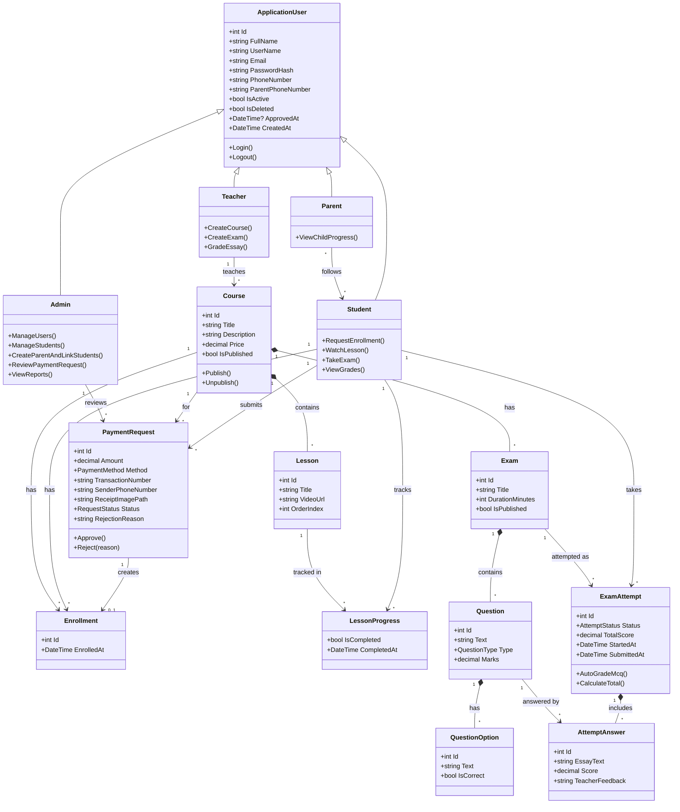

# 10. Class Diagram

> In the code and the database there is one user class, `ApplicationUser` (table `AspNetUsers`). Admin, Teacher, Student and Parent are **roles** managed by ASP.NET Core Identity (`AspNetRoles` and `AspNetUserRoles`), not separate subclasses. The four boxes above show what each role can do.
