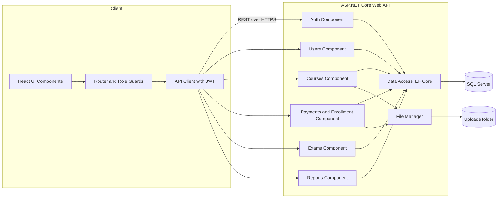
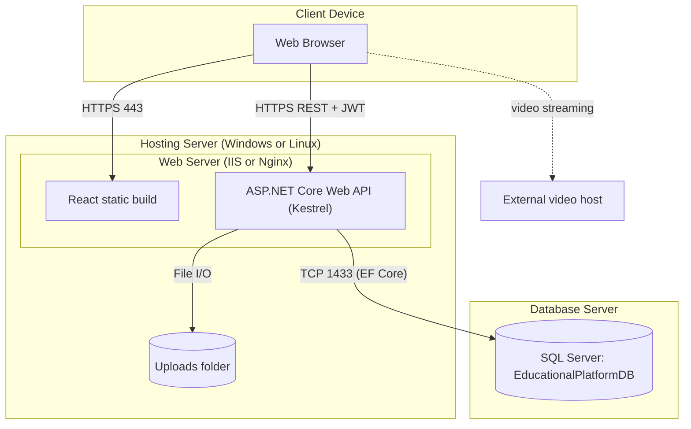

# 12. System Deployment & Integration

## 12.1 Technology Stack

| Layer | Technology |
|-------|------------|
| Frontend | React, React Router, Axios |
| Backend | ASP.NET Core Web API (C#), JWT authentication |
| ORM | Entity Framework Core (Code-First, migrations) |
| Database | SQL Server |
| File storage | Server file system (receipts, thumbnails) |
| Video | External video links |
| Version control | Git and GitHub |

## 12.2 Component Diagram

## 12.3 Deployment Diagram

## 12.4 Integration Points
| Integration | Type | Notes |
|-------------|------|-------|
| React ↔ Web API | REST / JSON over HTTPS | JWT in `Authorization: Bearer` header |
| Web API ↔ SQL Server | EF Core | Code-First migrations |
| Web API ↔ File system | File I/O | Receipts and thumbnails |
| Browser ↔ video host | Embedded player | No server-side integration |
| InstaPay / Vodafone Cash | **None (manual)** | Student pays outside the system and uploads the receipt |
