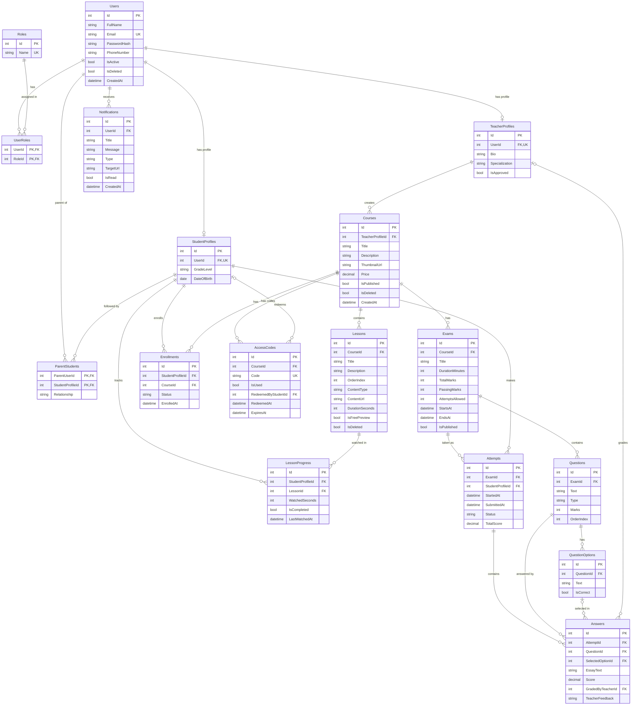

# Entity-Relationship Diagram (ERD)

**Project:** Educational Platform
**Section:** 4. System Analysis & Design, 4.2 Database Design & Data Modeling

The diagram below is written in Mermaid and renders automatically on GitHub.

## 1. ER Diagram

## 2. Entity Groups

| Group | Tables | Purpose |
|-------|--------|---------|
| Identity | Users, Roles, UserRoles, StudentProfiles, TeacherProfiles, ParentStudents | Login, roles, and linking parents to their children |
| Content | Courses, Lessons, LessonProgress | Teacher courses, lessons, and student watch progress |
| Enrollment | Enrollments, AccessCodes | Student subscription to a course, directly or by code |
| Exams | Exams, Questions, QuestionOptions, Attempts, Answers | Exams, auto-grading of MCQ, manual grading of essay |
| Notifications | Notifications | Grade and activity alerts for students and parents |

## 3. Relationships

| Relationship | Type | Meaning |
|--------------|------|---------|
| Users - Roles (through UserRoles) | Many-to-Many | A user can hold more than one role |
| Users - StudentProfiles | One-to-One | Only users with the Student role have a student profile |
| Users - TeacherProfiles | One-to-One | Only users with the Teacher role have a teacher profile |
| Users (parent) - StudentProfiles (through ParentStudents) | Many-to-Many | A parent follows many children, a child can have two parents |
| TeacherProfiles - Courses | One-to-Many | A teacher owns many courses |
| Courses - Lessons | One-to-Many | A course contains ordered lessons |
| StudentProfiles - Courses (through Enrollments) | Many-to-Many | A student enrolls in many courses |
| StudentProfiles - Lessons (through LessonProgress) | Many-to-Many | Watch progress per student per lesson |
| Courses - AccessCodes | One-to-Many | A teacher generates many codes for a course |
| Courses - Exams | One-to-Many | A course has many exams |
| Exams - Questions | One-to-Many | An exam has many questions |
| Questions - QuestionOptions | One-to-Many | A multiple-choice question has many options |
| Exams - Attempts | One-to-Many | An exam can be taken many times |
| Attempts - Answers | One-to-Many | One answer per question in each attempt |
| Users - Notifications | One-to-Many | A user receives many notifications |

## 4. Constraints

| Table | Constraint | Reason |
|-------|------------|--------|
| Users | Email is unique | One account per email |
| Roles | Name is unique | Admin, Teacher, Student, Parent |
| Enrollments | Unique (StudentProfileId, CourseId) | A student cannot enroll twice in the same course |
| LessonProgress | Unique (StudentProfileId, LessonId) | One progress row per student per lesson |
| AccessCodes | Code is unique | A code identifies exactly one record |
| Lessons | Unique (CourseId, OrderIndex) | Stable lesson ordering |
| Answers | Unique (AttemptId, QuestionId) | One answer per question per attempt |
| Answers | SelectedOptionId or EssayText is filled | Multiple-choice uses the option, essay uses text |

## 5. Design Decisions and Normalization

- **Roles are a separate table**, not a text column, so new roles can be added later without changing the schema.
- **Question options are a separate table** instead of columns like OptionA to OptionD. This allows any number of options and keeps the schema in 3NF.
- **Answers store the selected option by foreign key**, so multiple-choice answers are graded automatically by comparing with QuestionOptions.IsCorrect. Essay answers keep Score null until the teacher grades them.
- **Teacher and student data live in profile tables**, so the Users table stays small and shared by all roles.
- **Parents are users with the Parent role**, linked to children through ParentStudents.
- **Soft delete (IsDeleted)** on Users, Courses and Lessons, so history such as grades and progress is never lost.
- **Status and type columns** (Enrollments.Status, Attempts.Status, Questions.Type, Lessons.ContentType) are stored as short text or enum values, mapped to a C# enum in the code.
- **Normalization:** every table has a single primary key, no repeating groups (1NF), no partial dependencies on composite keys (2NF), and no transitive dependencies (3NF).
